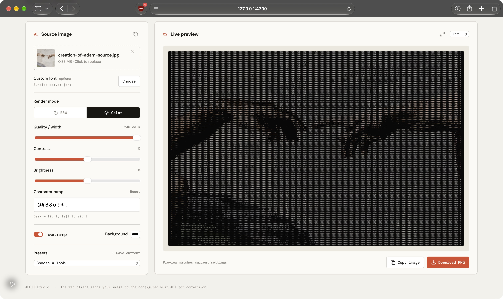
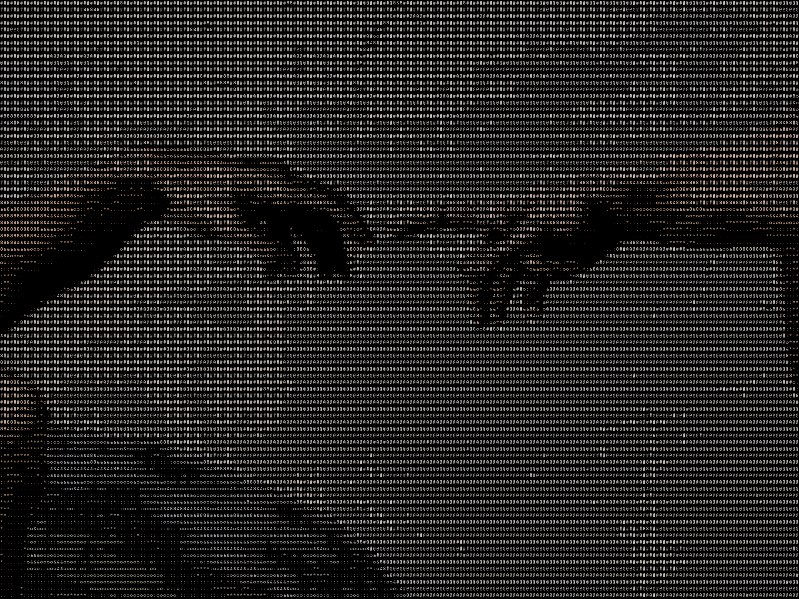

# ASCII Studio

Turn images into customisable character art with a React editor and a Rust renderer.
Upload an image, adjust its appearance, and download the result as a PNG.

**Rust · Axum · React · TypeScript · Vite**

[Quick start](#quick-start) · [Engineering decisions](#engineering-decisions) · [Tests](#tests) · [Development & API](docs/development.md) · [Deployment](docs/deployment.md)

## The editor



*Actual application screenshot after uploading and converting the sample image through the HTTP API.*

- Black-and-white and colour rendering with adjustable width, contrast, and brightness.
- Custom character ramps, ramp inversion, background colours, and uploaded fonts.
- Built-in presets and custom presets saved in the browser.
- Automatic previews after a 300 ms pause in editing, with loading/error states and retry.
- PNG downloads and browser-dependent image copying. Exports are enabled only for a result that matches the current settings.

## Example output

| Input | Colour character art |
| :---: | :---: |
| <a href="docs/images/creation-of-adam-source.jpg"></a> | <a href="docs/images/creation-of-adam-color.png"></a> |

Click either image for full resolution, or view the [black-and-white output](docs/images/creation-of-adam-bw.png). These examples use the shared Rust library; their settings and source credit are recorded in [the media notes](docs/media.md).

## Quick start

You need **stable Rust/Cargo**, **Node.js 24 and npm** (the frontend CI version), and a licensed TrueType font.

```sh
git clone https://github.com/alex2qw/ASCII-image-converter.git
cd ASCII-image-converter
./run.sh
```

The launcher installs frontend dependencies if needed and starts both services.
Open the Vite URL printed in the terminal, usually `http://localhost:5173`.
The API listens on `http://127.0.0.1:3000`. Press `Ctrl+C` to stop both.

On macOS, the launcher finds a system font. On other systems, or to choose a monospace font explicitly:

```sh
ASCII_FONT_PATH=/absolute/path/to/monospace.ttf ./run.sh
```

Prefer a container? See the [Docker quick start](docs/deployment.md#docker).

## How it works

```text
React editor → multipart POST /convert → Axum API → blocking conversion worker
                                                        ↓
                        PNG preview/download ← Rust image-to-character renderer
```

The renderer checks input dimensions and planned output size before full pixel decoding. It resizes the image to a character grid, normalises luminance, applies the editor settings, maps values to a character ramp, and draws glyphs into a PNG.

The library is shared by the HTTP service and CLI. Callers supply image and font bytes, keeping conversion independent of web requests and operating-system font paths.

## Engineering decisions

| Concern | Approach | Tradeoff |
| :--- | :--- | :--- |
| Expensive conversion work | Tokio blocking workers with two admission slots by default | Extra requests receive HTTP 503 rather than waiting in a queue |
| Large allocations | Input-byte, input-pixel, and rendered-output limits | Limits apply per conversion; they are not a total process-memory guarantee |
| Client cancellation | The worker keeps its permit until it finishes | Disconnecting does not stop work already running |
| Stale previews | Cancel old requests and check that results match current inputs | Exports stay disabled until the latest conversion succeeds |

## Tests

```sh
cargo test --locked --manifest-path backend/Cargo.toml
npm --prefix frontend ci
npm --prefix frontend test
npm --prefix frontend run build
```

The real HTTP suite launches the compiled server, uploads images, decodes returned PNGs, and checks rendering, errors, and server-enforced limits. It needs a licensed font and permission to bind localhost, so it runs separately:

```sh
ASCII_TEST_FONT=/absolute/path/to/monospace.ttf \
  cargo test --locked --manifest-path backend/Cargo.toml --test api_e2e -- --ignored
```

[GitHub Actions](.github/workflows/ci.yml) runs Rust tests, the HTTP suite, formatting, Clippy, and the frontend tests/build. See [all check commands and coverage](docs/development.md#automated-checks).

## Current limitations

- Exports are PNG images; plain-text ASCII export is not implemented.
- The decoder’s allocation budget is best-effort for some formats. Intermediate buffers and simultaneous requests require additional memory.
- Slow uploads occupy admission slots. Upload timeouts and deployment-wide memory controls remain separate concerns.
- Automated tests cover frontend behaviour and the real API; automated browser interaction and container deployment tests are not included.

## Explore the code

- [Rust conversion library](backend/src/conversion) — options, validation, rendering, and typed errors.
- [HTTP service](backend/src/bin/server.rs) — multipart requests, limits, worker admission, and static frontend serving.
- [React editor](frontend/src/app/App.tsx) and [conversion lifecycle](frontend/src/app/hooks/useConversion.ts).
- [API end-to-end tests](backend/tests/api_e2e.rs).

For setup details, the CLI, library usage, and API configuration, read the [development guide](docs/development.md). For Docker, Render, and Hugging Face Spaces, read the [deployment guide](docs/deployment.md).
